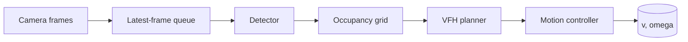

# Architecture v2 — three-tier distributed control

**Status:** Target design for v0.2. The running system today is still the v0.1 simulation described in
[ARCHITECTURE.md](ARCHITECTURE.md). Nothing in this document is physically integrated.

**Related decisions:** [ADR-0001](adr/ADR-0001.md) (three-tier model, downward-only safety authority) ·
[ADR-0002](adr/ADR-0002.md) (ESP32-S3 primary) · [ADR-0003](adr/ADR-0003.md) (binary framing) ·
[ADR-0004](adr/ADR-0004.md) (freshness) · [ADR-0005](adr/ADR-0005.md) (velocity scale) ·
[ADR-0006](adr/ADR-0006.md) (measured latency budget)

**Related:** [PROTOCOL-v2.md](PROTOCOL-v2.md) · [HARDWARE.md](HARDWARE.md) · [ROADMAP.md](ROADMAP.md)

---

## 1. The one rule that defines the architecture

> **Safety authority flows downward only.**

Tier 1 may *request* motion. Only Tier 3 may *grant* it. Every tier below the requester is free to
refuse, and refusal is the default.

This is not a slogan, it is the reason the system is split into three tiers at all. A single-board
design that owned perception, planning and actuation together would give the planner the authority
to keep driving when its own inputs go bad. Here, the planner's failure mode is bounded by a tier it
does not control:

| Failure | Resolves to |
|---|---|
| Laptop process dies | Wi-Fi drops → ESP32 stops relaying → Arduino watchdog expires → stop |
| Laptop hangs (no commands) | Arduino watchdog expires at 300 ms → stop |
| Wi-Fi drops | Same as laptop death — the Arduino never sees a command from the relay |
| Camera fails | Perception produces no detections → no fresh obstacle evidence → Tier 3 reflex governs |
| Sonar fails | Distance reads invalid → reflex cannot trigger, so Tier 3 refuses to grant nominal motion |
| Arduino reboots | Watchdog starts **expired**; motion is not granted until the first accepted, fresh command |

A reconnect **never** authorises motion. A heartbeat **never** renews motion authority. A command
that arrives late is **rejected**, not treated as fresh (see [ADR-0004](adr/ADR-0004.md)).

The physical emergency stop is a fourth, independent path that is not represented in any of the
three tiers. It is wired to hardware, not to software, and no protocol can inhibit it.

---

## 2. Tier model

| Tier | Hardware | Owns | Never owns |
|---|---|---|---|
| **1. Perception & Planning** | Laptop (Python) | camera → detections → costmap → VFH → motion controller → `(v, ω)` | safety decisions, motor actuation |
| **2. Edge Gateway** | ESP32-S3 (FreeRTOS) | camera DMA, WebSocket client, telemetry forwarding, UART bridge | path planning, collision policy |
| **3. Actuation & Safety** | Arduino Uno R3 | sonar FSM, subsumption arbiter, watchdog, motor PWM | autonomy, route planning |

Note what Tier 2 does **not** own. The ESP32-S3 is a transport and sensor-aggregation tier. It is
never asked "is it safe to move?" — it does not have the sensor timing, the loop determinism or the
physical outputs required to answer that honestly.

Likewise Tier 1 never touches a motor. It produces a *velocity request* in a normalised range and
nothing else.

---

## 3. Tier 1 — Local AI Workstation

**Language:** Python 3.10+. **No ROS dependency.**

### 3.1 Pipeline



Frame ingestion is decoupled from inference. The queue holds **one** slot, not a backlog: a frame
that is superseded before inference starts is discarded, because a stale frame is worse than no
frame. This is to be implemented as `LatestFrameQueue` and `PerceptionPipeline` in
`taxi/perception/pipeline.py`, with the freshness rule (`max_age_s`) enforced before a frame
reaches the backend.

### 3.2 Modules (specified, not yet implemented)

> **None of the modules below exist in this repository.** They are the target structure. The
> module paths given are the paths they are to be created at.

| Module | Role | Status |
|---|---|---|
| `taxi/perception/base.py` | `Frame`, `Detection`, `Observation`, `PerceptionBackend` protocol | To implement |
| `taxi/perception/pipeline.py` | `LatestFrameQueue`, `PerceptionPipeline` | To implement |
| `taxi/perception/detectors.py` | `NullBackend`; `OpenCVBackend` interface | To implement — `OpenCVBackend` raises `NotImplementedError` |
| `taxi/planning/occupancy.py` | `OccupancyGrid`, `SensorReading` | To implement |
| `taxi/planning/vfh.py` | `compute_candidate_direction` | To implement |
| `taxi/planning/controller.py` | `Controller`, `bearing_between` | To implement |
| `taxi/mission/safety.py` | `SubsumptionArbiter` — host-side mirror of the Arduino arbiter | To implement |

`OpenCVBackend` is to be a **stub**. No detector weights are bundled with this repository and none
are downloaded at import or run time. Until real weights and a confirmed camera are in place, the
only enabled backend is to be `NullBackend`, which reports no detections. A deployment that treats
"no detections" as "no obstacles" would be wrong — see §3.4.

### 3.3 Planning detail

**Occupancy grid** (`taxi/planning/occupancy.py`). A fixed-resolution 2D grid over the campus map
area, with a known-obstacle layer and a sensor-projection helper. Points outside the grid are
treated as occupied: the planner must not reason about free space it cannot see.

**VFH** (`taxi/planning/vfh.py`). Candidate directions are scored against the accumulated obstacle
histogram. The implementation computes a candidate direction over a set of bearings and returns
`None` when **every** candidate is blocked — which is the important edge case: the planner must be
able to say "I have no valid heading" instead of picking the least-bad one and driving into a wall.

**Controller** (`taxi/planning/controller.py`). Converts a target bearing into `(v, ω)` with
acceleration clamping. A large heading error reduces linear speed rather than being satisfied
entirely by angular velocity.

### 3.4 The sensor-validity rule

> **Missing or stale sensors are invalid, never substituted with fabricated healthy values.**

This is a repository-wide rule, not a planning detail. A `SensorReading` whose `distance_cm` is
`None` marks **nothing** in the grid — it does not mark the cell free, and it does not mark it
occupied. `None` means "no evidence", and the planner must reach the conclusion that it cannot
safely proceed, rather than the conclusion that the path ahead is clear.

The same rule governs the host-side telemetry adapters to be written in `taxi/comms/`: `assess()`
marks a sample invalid when it is stale, when a required key is missing, or when the source reports
`sensors_ready=false`. An invalid sample carries a **reason** and empty values. It is never
coerced into a healthy-looking reading.

---

## 4. Tier 2 — ESP32-S3 Edge Gateway

**Board:** `esp32-s3-devkitc-1` · **Platform:** `espressif32@6.9.0` · **Framework:** Arduino-ESP32 ·
**Target location:** `firmware/esp32_s3/`

> **This tier is not implemented.** There is no `firmware/esp32_s3/` directory in this repository.
> The board in hand is the ESP32-CAM, which stays supported as a bench fallback
> ([ADR-0002](adr/ADR-0002.md)).

### 4.1 FreeRTOS task layout

The S3's dual Xtensa cores are used to separate I/O from protocol work.

| Core | Task | Priority | Responsibility |
|---|---|---|---|
| 0 | `Task_NetworkClient` | 4 | WebSocket session, frame uplink, command downlink |
| 0 | `Task_CommandRelay` | 3 | Decode received commands, freshness-check, relay over UART |
| 1 | `Task_CameraCapture` | 5 | Camera DMA into PSRAM, JPEG encode, frame handoff |
| 1 | `Task_TelemetryPoll` | 2 | Poll the Arduino for telemetry, publish upstream |

The camera task sits at the highest priority because a capture deadline missed is a dropped frame,
and frames are the most latency-sensitive thing the gateway carries. The telemetry poll sits lowest
because a telemetry sample that is one cycle late is merely stale — and stale telemetry is
explicitly invalid data, not a safety hazard.

Camera configuration target: **PSRAM dual frame buffers** (`fb_count=2`), `PIXFORMAT_JPEG`,
QVGA or VGA, `jpeg_quality=12`. Two buffers let capture continue while the previous frame is being
encoded and transmitted, without allocating on the heap during steady-state operation.

### 4.2 Target state

The task skeleton, with the core affinity and priorities above, is to be implemented in
`firmware/esp32_s3/src/main.cpp`. The camera and network task bodies are to be **stubs** that
compile and run but do not open a camera or bind a socket until the board is confirmed.

**Every camera pin and every UART pin is to be set to `-1`.** The pin map must come from the
confirmed board, not from a datasheet guess — see [HARDWARE.md](HARDWARE.md). A guardrail test
that fails if any `kCameraPin*`, `kUartTxPin` or `kUartRxPin` constant is given a value is to be
added with the implementation.

### 4.3 Framing mirror

`firmware/esp32_s3/src/framing.{h,cpp}` is to be a byte-for-byte mirror of
`taxi/protocol/framing.py`. The two are not to be kept in sync by convention; they are to be kept
in sync by a shared-vector test, which compiles the C++ and asserts that both implementations
produce identical bytes for the same input vectors. A framing mismatch is silent and dangerous, so
it must be tested rather than trusted.

---

## 5. Tier 3 — Arduino Uno R3 Actuation and Safety

**Target:** `uno` · **Platform:** `atmelavr@5.1.0` · **Location:** `firmware/arduino/`

### 5.1 The 50 Hz cyclic loop

The main loop runs at **50 Hz (20 ms)**, non-blocking. There are no `delay()` calls and no
`pulseIn()` in the control path — `pulseIn()` blocks for the duration of the measurement and would
stall the watchdog, the arbiter and the actuator update. Echo capture is interrupt-driven (PCINT)
instead, and the main loop only consumes the captured result.

### 5.2 Sonar state machine

A 3-phase round-robin, so no single sensor is sampled more than once per 60 ms and the CPU is not
blocked waiting for an echo:

| Phase | Offset | Sensor |
|---|---|---|
| 0 | 0 ms | centre |
| 1 | 25 ms | left |
| 2 | 50 ms | right |

Echo timeout is 5 ms. A reading that times out is **invalid** (`-1`), and an invalid reading does
not clear the previous obstacle. `SonarFsm` also tracks the **age** of each reading, so the arbiter
can distinguish "no obstacle" from "no information".

### 5.3 Subsumption arbiter

The arbiter evaluates three tiers and selects the highest-priority one that applies. This ordering
is to be mirrored exactly in `taxi/mission/safety.py`, and asserted by a guardrail test which reads
the tier names and their order out of the C++ header and compares them to the Python side.

| Priority | Tier | Condition | Effect |
|---|---|---|---|
| 0 | Fail-safe | Watchdog expired (> 300 ms since last accepted command) | Stop. Latched. |
| 1 | Emergency reflex | Centre distance < 20 cm, or side distance < 15 cm | Stop / reverse-free emergency stop |
| 2 | Nominal execution | Valid fresh command, sensors valid | Execute `(v, ω)` |

Two properties of this ordering matter:

- **The watchdog outranks the reflex.** If the link has died *and* something is in front of the
  vehicle, the fail-safe tier is still the one that speaks, because the reflex's distance data is
  itself only trustworthy while the board is alive.
- **A missing sensor does not trigger the reflex.** "No reading" is not "reading zero". The reflex
  fires only on a *valid* measurement below threshold. A missing sensor therefore falls through to
  the watchdog/fail-safe tier rather than being mistaken for an imminent collision.

The emergency thresholds (**20 cm centre, 15 cm sides**) and the watchdog timeout (**300 ms**) are
**provisional values carried over from the design proposal**. They have not been measured against
the real vehicle. `docs/HARDWARE.md` requires them to be re-derived from bench measurement before
any autonomous motion (see [ADR-0006](adr/ADR-0006.md)).

### 5.4 Differential kinematics

For a differential-drive platform with normalised linear velocity `v ∈ [-1, 1]` and normalised
angular velocity `ω ∈ [-1, 1]`:

```text
PWM_left  = constrain((v - ω) × 255)
PWM_right = constrain((v + ω) × 255)
```

The solver is to be implemented in `firmware/arduino/src/kinematics.{h,cpp}` and is unit-testable
without hardware because it contains no I/O.

### 5.5 Current state — bench parser only

> **The Arduino tier is not implemented.** `firmware/arduino/src/` contains `main.cpp` alone. There
> is no `sonar_fsm`, `arbiter`, `watchdog` or `kinematics` module, no 50 Hz control loop, and no
> obstacle reflex.

The current firmware is a **newline-ASCII bench parser**: it handles `PING`, `STOP` and JSON
telemetry over USB serial. It has no sensors, no motors, and no way to be commanded to move.

When the tier is implemented it is to remain structurally incapable of driving anything until the
hardware is confirmed:

- **No actuator GPIO is to be assigned.** A guardrail test is to fail if `analogWrite`,
  `digitalWrite` or `MOTOR_PIN` appears in `firmware/arduino/src/main.cpp`.
- The echo callbacks (`onTrigger`, `onCapture`) are to be **empty**, so every sonar reading stays
  invalid. The FSM runs, but it never observes a real echo.
- `sensors_ready` and `motion_enabled` are to be reported `false`.

---

## 6. Protocol summary

Full byte layouts are in [PROTOCOL-v2.md](PROTOCOL-v2.md). The three interfaces:


### 6.1 Server ↔ ESP32 (WebSocket)

**Upstream.** Binary video frames carry a sequence number and timestamp header followed by the JPEG
payload. JSON telemetry is published at 10 Hz and reports values together with their source, age
and validity.

**Downstream.** The motion command is a fixed **16-byte** frame:

```text
0  1  2  3  4  5  6  7  8  9  10 11 12 13 14 15
[ magic  ][ type | flags ][ session id     ][ sequence  ][ linear | angular | crc8 ]
```

The full field table is in [PROTOCOL-v2.md](PROTOCOL-v2.md). Note that the design proposal
described this packet as "fixed 8-byte" while listing only seven bytes of content; the implemented
frame is 16 bytes and carries the session id and sequence needed for the freshness model.

### 6.2 ESP32 ↔ Arduino (UART)

115200 baud, COBS framing with CRC-8, bounded frame length of 64 bytes.

**Motion (18 bytes):** `[0xAA][type][version][session][sequence][v:int16][w:int16][timestamp][crc8][0x55]`
**Telemetry (11 bytes):** `[0xAA][type][L][C][R][bits][uptime][age][crc8][0x55]`

Both hops carry the velocities as `int16` on the **canonical** `±1000` scale. The draft's
`int8 ±100` UART form is not what was implemented: the canonical domain is used everywhere and the
conversion helpers (`normalise_for_uart` / `expand_from_uart`) exist for the reduced-width case
rather than for the current layout. See [ADR-0005](adr/ADR-0005.md) and
[PROTOCOL-v2.md](PROTOCOL-v2.md) §4.

### 6.3 Freshness

A motion command carries a session id, a monotonic sequence number and a timestamp. The Arduino
accepts a command only if:

1. the session id matches the current session,
2. the sequence number is strictly greater than the last accepted one, and
3. the timestamp age is within the permitted window.

A **future-dated** command is rejected as firmly as an expired one. Clock uncertainty *widens* the
acceptance window; it never loosens the freshness requirement. A heartbeat does not renew motion
authority, and a session change flushes any pending commands. See
[ADR-0004](adr/ADR-0004.md).

---

## 7. Latency budget

| Stage | Budget |
|---|---|
| Camera capture → JPEG available | 20–30 ms |
| JPEG encode + frame header | 5–10 ms |
| Network uplink (campus Wi-Fi) | 15–25 ms |
| Inference + occupancy update | 8–15 ms |
| VFH + controller | 2–5 ms |
| Network downlink | 15–25 ms |
| UART relay | 2–4 ms |
| **End-to-end** | **54–84 ms** (design target ≤ 120 ms) |
| Watchdog halt | 300 ms |

**Every physical threshold in this table is provisional.** The budgets were allocated by design
reasoning, not measurement. [ADR-0006](adr/ADR-0006.md) requires each one to be re-derived from
bench measurement before it is treated as a physical limit, and explicitly forbids simulator
constants from becoming physical thresholds.

---

## 8. Target module map

> **This is the map the implementation is to take.** Only the lines marked *(v0.1, exists)* are
> present in this repository today.

```text
taxi/
  protocol/      framing.py    COBS + CRC-8, pure encode/decode
                 motion.py     MotionCommand, freshness rules, MOTION_SCALE
                 telemetry.py  TelemetryFrame, state bits, invalid-distance sentinel
                 transport.py  network / UART packet layouts
  comms/         base.py       TelemetrySample, TelemetrySource protocol
                 health.py     assess() — shared freshness/validity rules
                 simulated.py  simulation-backed source
                 esp32.py      read-only device adapter
  perception/    base.py       Frame, Detection, Observation, backend protocol
                 pipeline.py   LatestFrameQueue, PerceptionPipeline
                 detectors.py  NullBackend (enabled), OpenCVBackend (stub)
  planning/      occupancy.py  OccupancyGrid, SensorReading
                 vfh.py        candidate-direction scoring
                 controller.py Controller, bearing_between
  mission/       state.py      VehicleState, TripStatus, terminal statuses
                 safety.py     SubsumptionArbiter (host mirror of the C++ arbiter)
  supervisor.py   the existing v0.1 simulation — unchanged public surface   (v0.1, exists)
  api.py, storage.py, navigation.py, static/   the existing v0.1 application  (v0.1, exists)

firmware/
  esp32_s3/      platformio.ini, src/{main.cpp, framing.h, framing.cpp, protocol.h}
  arduino/       platformio.ini, src/{main.cpp, arbiter, watchdog, sonar_fsm, kinematics}
  esp32_cam/     the existing v0.1 bench starter — still supported          (v0.1, exists)
```

`taxi/protocol/` is to contain **no I/O**: no clock, no socket, no thread. The clock is always
injected. That is what lets the same definitions be reused by the host adapter and mirrored by the
firmware.

---

## 9. What exists today versus what is planned

| Area | Today (v0.1) — **exists** | Target (v2) — **not implemented** |
|---|---|---|
| Host stack | Simulation, one supervisor, dashboard | Perception → planning → control pipeline |
| Edge | ESP32-CAM bench starter | ESP32-S3 with FreeRTOS task layout and PSRAM camera |
| Actuation | Bench parser (newline ASCII, no sensors, no motors) | Disarmed 50 Hz loop with real FSM/arbiter structure |
| Protocol | Newline ASCII over UART | COBS + CRC-8 binary, versioned, freshness-checked |
| Safety | Host-side latching only | Host + edge + Arduino tiers, downward-only authority |

The v2 hardware tiers are **not present in this repository**. There is no code path from a Python
call to a motor PWM write, and no firmware in the tree can drive a motor at all.

---

## 10. Sources

- FreeRTOS task priorities and API: https://www.freertos.org/Documentation/02-Kernels/02-Kernel-features/02-Tasks/02-Task-priorities
- ESP32-S3 PSRAM and camera: https://github.com/espressif/esp32-camera
- Arduino Uno R3: https://docs.arduino.cc/hardware/uno-rev3/
- COBS: https://en.wikipedia.org/wiki/Consistent_Overhead_Byte_Stuffing
